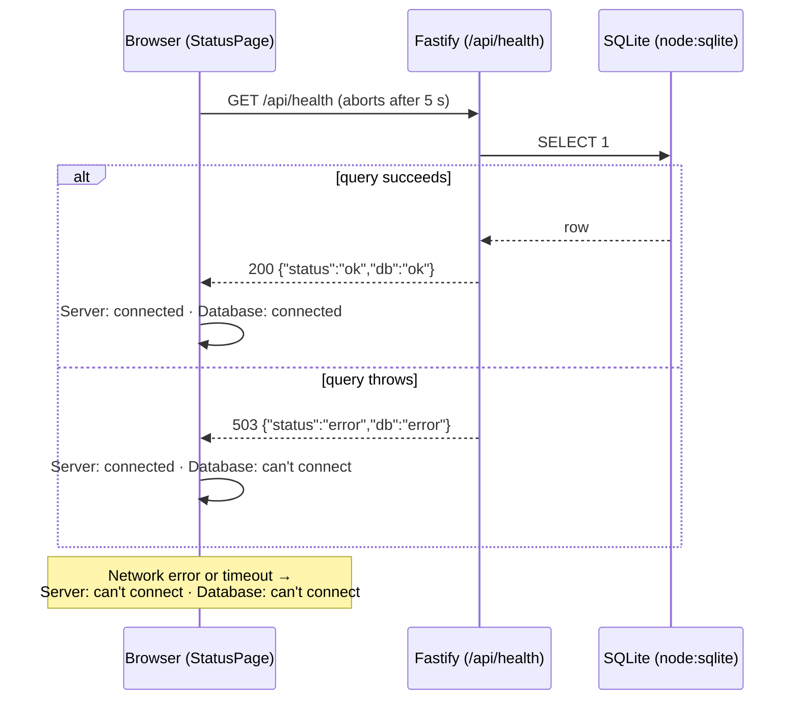

# Project Skeleton Design

**Spec**: `.specs/features/0001-project-skeleton/spec.md`
**Status**: Approved - 2026-11-06 - user: "a´rrpved"

---

## Architecture Overview

The repo is a single npm package. There are three source folders under `src/`: `web` (React, runs in the browser), `server` (Fastify, runs in Node) and `shared` (code both sides import, today only the health response contract). Node 26 runs the server's `.ts` files directly through built-in type stripping, so the server needs no build step. Only the web app is built, by Vite, into `dist/web`.

In development, Vite serves the web app with hot reload on port 5173 and forwards `/api/*` to the Fastify server on port 3000. In production (`npm start`), one Fastify process serves `dist/web` and the API on `0.0.0.0:3000`.



**Where the rules run.** Both rules that change what the user sees are pure functions with unit tests, outside the components:
- `toHealthView(result)` maps an HTTP result (status, body, or a network error) to the two displayed states.
- `detectLanguage(saved, browserLanguages)` picks `en` or `pt-BR`.

Components only render what those functions return.

---

## Code Reuse Analysis

### Existing Components to Leverage

| Component | Location | How to Use |
| --- | --- | --- |
| Product brief | `docs/product.md` | Source of the LAN-only, no-login, en + pt-BR constraints |
| ADR-001 | `docs/adr/001-use-react-typescript-node-and-sqlite.md` | Stack this design conforms to |
| Prototype color tokens | Routinely prototype artifact (`:root` tokens) | Copy the light/dark CSS variables (`--bg`, `--ink`, `--muted`, `--accent`, `--bad`) into `src/web/styles.css` so the status page already uses the product's palette |

No application code exists yet.

### Integration Points

| System | Integration Method |
| --- | --- |
| SQLite | `node:sqlite` `DatabaseSync`, opened once at startup from `DATABASE_PATH` |
| GitHub | `.github/workflows/ci.yml`; runs once the user creates and pushes the repo |

---

## Components

### Shared health contract

- **Purpose**: One definition of the `/api/health` response, used by the server to answer and by the browser to parse.
- **Location**: `src/shared/health.ts`
- **Interfaces**:
  - `HealthResponse` - zod schema `{ status: "ok" | "error", db: "ok" | "error" }`
  - `type HealthResponse = z.infer<typeof HealthResponse>`
- **Dependencies**: zod
- **Reuses**: -

### Database

- **Purpose**: Open (and create if missing) the SQLite file and answer a ping.
- **Location**: `src/server/db.ts`
- **Interfaces**:
  - `openDatabase(path: string): Database` - creates missing parent folders, then opens the file
  - `interface Database { ping(): void; close(): void }` - `ping` runs `SELECT 1` and throws on failure
- **Dependencies**: `node:sqlite`, `node:fs`
- **Reuses**: -

### API app

- **Purpose**: Build the Fastify instance with its routes, without listening, so tests can call it with `app.inject()`.
- **Location**: `src/server/app.ts`, `src/server/routes/health.ts`
- **Interfaces**:
  - `buildApp(deps: { db: Database; webRoot?: string }): FastifyInstance`
  - `GET /api/health` → `200 {"status":"ok","db":"ok"}` or `503 {"status":"error","db":"error"}`
  - When `webRoot` exists: serves static files from it, and returns `index.html` for any non-`/api` GET that matches no file. Unknown `/api/*` paths return `404` JSON.
- **Dependencies**: fastify, @fastify/static, Database, shared health contract
- **Reuses**: -

### Server entry

- **Purpose**: Read the environment, open the database, start listening, and handle a busy port.
- **Location**: `src/server/index.ts`
- **Interfaces**:
  - Env: `PORT` (default `3000`), `DATABASE_PATH` (default `data/routinely.db`); host is always `0.0.0.0`
  - On listen: logs `Routinely listening on http://0.0.0.0:<port>`
  - On `EADDRINUSE`: logs `Port <port> is already in use` to stderr and exits with code `1`
- **Dependencies**: API app, Database
- **Reuses**: -

### Health view rule

- **Purpose**: Turn the health check result into what the page shows.
- **Location**: `src/web/health/healthView.ts`
- **Interfaces**:
  - `type HealthResult = { kind: "response"; status: number; body: unknown } | { kind: "failed" }`
  - `toHealthView(result: HealthResult): { server: "connected" | "unreachable"; db: "connected" | "unreachable" }`
- **Dependencies**: shared health contract
- **Reuses**: -

### useHealth hook

- **Purpose**: Run the health check once on mount, with a 5-second timeout, and expose its state.
- **Location**: `src/web/health/useHealth.ts`
- **Interfaces**:
  - `useHealth(): { state: "checking" } | { state: "done"; view: HealthView; checkedAt: Date }`
  - Uses `fetch("/api/health", { signal: AbortSignal.timeout(5000) })`; any thrown error becomes `{ kind: "failed" }`
- **Dependencies**: health view rule
- **Reuses**: -

### Status page

- **Purpose**: Render the heading, the two status lines, "Checked at {time}" and the language switch.
- **Location**: `src/web/StatusPage.tsx`, `src/web/LanguageSwitch.tsx`, `src/web/App.tsx`, `src/web/main.tsx`, `index.html`, `src/web/styles.css`
- **Interfaces**: React components; all text via `useTranslation()`; time via `Intl.DateTimeFormat(lang, { hour: "numeric", minute: "2-digit" })`
- **Dependencies**: useHealth, i18n
- **Reuses**: prototype color tokens

### i18n

- **Purpose**: Load the en and pt-BR strings, choose the first language, remember the user's choice, and keep `<html lang>` in sync.
- **Location**: `src/web/i18n/index.ts`, `src/web/i18n/detectLanguage.ts`, `src/web/i18n/en.json`, `src/web/i18n/pt-BR.json`
- **Interfaces**:
  - `detectLanguage(saved: string | null, browserLanguages: readonly string[]): "en" | "pt-BR"` - a saved `en`/`pt-BR` wins; otherwise `pt-BR` when the first browser language starts with `pt`, else `en`
  - Storage key `routinely.lang` in `localStorage` (reads and writes in `try/catch`)
  - On `languageChanged`: writes the key and sets `document.documentElement.lang`
- **Dependencies**: i18next, react-i18next
- **Reuses**: -

### Harness

- **Purpose**: The commands, configs and CI that check every change.
- **Location**: `package.json` scripts, `tsconfig.json` + `tsconfig.web.json` + `tsconfig.node.json`, `vite.config.ts` (includes the Vitest projects), `playwright.config.ts`, `eslint.config.js`, `.prettierrc.json`, `.github/workflows/ci.yml`, `.nvmrc`, `.gitignore`, `CLAUDE.md`, `e2e/`
- **Interfaces** (npm scripts):

| Script | Runs |
| --- | --- |
| `dev` | `concurrently` → `vite` + `node --watch src/server/index.ts` |
| `build` | `vite build` → `dist/web` |
| `start` | `node src/server/index.ts` |
| `typecheck` | `tsc -p tsconfig.web.json` then `tsc -p tsconfig.node.json` (both `noEmit`, `strict`) |
| `lint` | `eslint .` |
| `format` / `format:check` | `prettier --write .` / `prettier --check .` |
| `test` | `vitest run` (project `web` on jsdom, project `server` on node) |
| `e2e` | `playwright test` (its `webServer` runs build + start on port 3100 with a temp `DATABASE_PATH`) |
| `check` | typecheck → lint → format:check → test → build, stopping at the first failure |

- **Dependencies**: see Tech Decisions
- **Reuses**: -

---

## Data Models

No tables. The database is opened and pinged with `SELECT 1`; the first planner feature adds the schema (and picks the ORM, AD-003).

```typescript
// src/shared/health.ts
export const HealthResponse = z.object({
  status: z.enum(["ok", "error"]),
  db: z.enum(["ok", "error"]),
});
export type HealthResponse = z.infer<typeof HealthResponse>;
```

---

## Error Handling Strategy

| Error Scenario | Handling | User Impact |
| --- | --- | --- |
| `SELECT 1` throws | Route catches, answers `503 {"status":"error","db":"error"}` | "Server: connected" · "Database: can't connect" |
| `DATABASE_PATH` can't be opened at startup | `openDatabase` throws; the entry logs the path and exits `1` | Server doesn't start; the page (if served by Vite) shows "Server: can't connect" |
| API down, network error, or no answer in 5 s | `fetch` rejects (incl. `AbortSignal.timeout`) → `{ kind: "failed" }` | "Server: can't connect" · "Database: can't connect" |
| Response body doesn't match `HealthResponse` | `toHealthView` treats it as server reachable, database unreachable | "Server: connected" · "Database: can't connect" |
| Port in use | Entry catches `EADDRINUSE`, logs the port, exits `1` | Owner sees the message in the terminal |
| `localStorage` blocked | `try/catch`; language still works for the session | Choice isn't remembered after reload |

Failure lines use the `--bad` color, the only place red appears, which the product brief allows for real errors.

---

## Risks & Concerns

| Concern | Location (file:line) | Impact | Mitigation |
| --- | --- | --- | --- |
| typescript-eslint supports TypeScript `>=4.8.4 <6.1.0`; npm `latest` is 7.0.2 | `package.json` | Installing TS 7 breaks type-aware lint | Pin `typescript@6.0.3`; revisit when typescript-eslint supports 7 |
| Drizzle has no `node:sqlite` driver (only better-sqlite3, bun, expo, op-sqlite, proxy) | - | The ORM choice in the first planner feature may mean switching to better-sqlite3 | AD-003 defers the ORM; the `Database` interface keeps the driver behind one module |
| Node type stripping only handles erasable syntax (no `enum`, `namespace`, parameter properties) | `tsconfig.node.json` | Such syntax would crash the server at runtime | `erasableSyntaxOnly: true` makes `tsc` reject it; imports use `.ts` extensions (`allowImportingTsExtensions`) |
| Playwright downloads a Chromium build (~150 MB) | `e2e/`, CI | First local `npm run e2e` is slow or blocked offline | `npx playwright install chromium` documented in `CLAUDE.md`; CI caches it |
| Fastify 5 / @fastify/static 10 compatibility not checked yet | `package.json` | Install-time peer warning | Check at install; pin the versions that resolve cleanly |

---

## Tech Decisions

| Decision | Choice | Rationale |
| --- | --- | --- |
| Repo layout | Single package, `src/{web,server,shared}` | User choice; least tooling (AD-001) |
| Server framework | Fastify 5 | User choice; typed routes, `inject()` for tests (AD-002) |
| Database access | `node:sqlite`, plain SQL; ORM with the first schema | User choice; no native module, no premature schema (AD-003) |
| Server runtime | Node 26 runs `.ts` directly, no server build | No compile step; `tsc` only checks (AD-004) |
| TypeScript | 6.0.3, `strict`, two tsconfigs (DOM / Node) sharing `src/shared` | typescript-eslint ceiling; browser and Node globals kept apart |
| Lint / format | ESLint 10 + typescript-eslint (type-aware) + eslint-plugin-react-hooks + Prettier | User choice; hooks rules matter most when learning React |
| Unit / component tests | Vitest 5 with two projects (jsdom / node) + React Testing Library + user-event + jest-dom | Same config as Vite; one `vitest run` covers both sides |
| E2E | Playwright (Chromium only) | Real browser; tests the 360 / 1280 px widths |
| Validation | zod 4 for the shared health contract | Types derived from the schema; the browser parses, not trusts |
| i18n | i18next + react-i18next; own `detectLanguage` instead of the detector plugin | The rule is two lines and gets its own test |
| Dev runner | concurrently (vite + `node --watch`) | One `npm run dev` |
| CI | GitHub Actions, `actions/setup-node` with `node-version-file: .nvmrc` | User choice; one Node version source |
