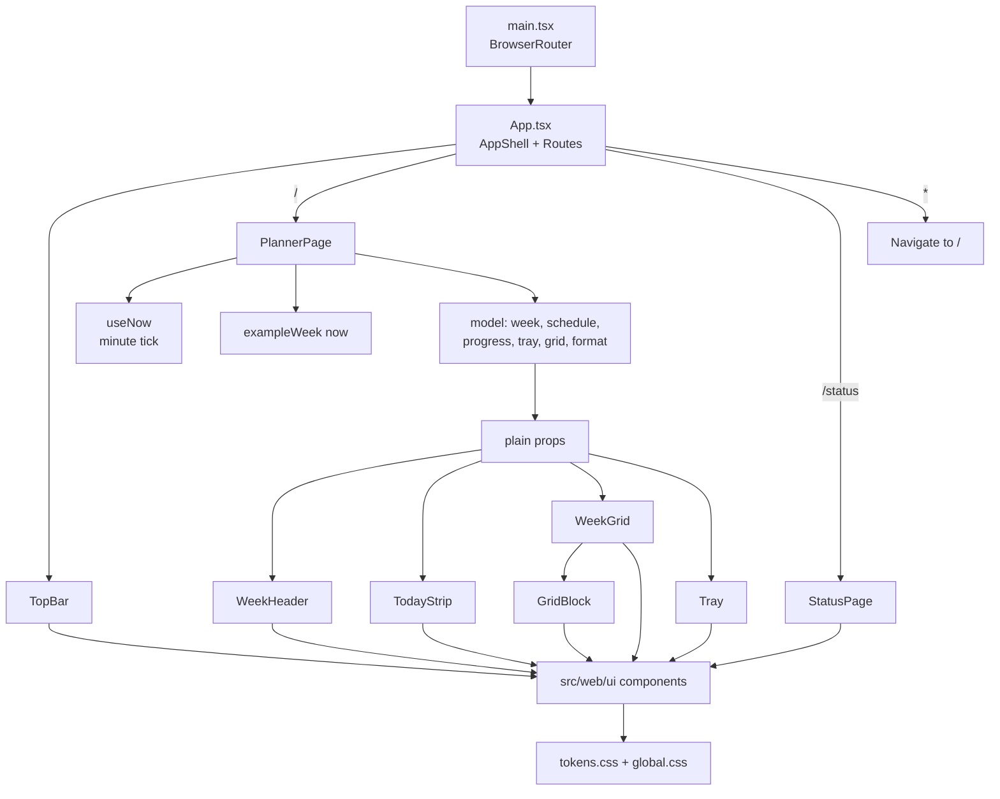

# Main Layout Design

**Spec**: `.specs/features/0002-main-layout/spec.md`
**Context**: `.specs/features/0002-main-layout/context.md`
**Status**: Approved

---

## Architecture Overview

Three layers, each tested on its own:

1. **Design system** (`src/web/ui/`): tokens, global styles and generic components. It knows nothing about planners; every text arrives as a prop. Only this folder may render raw interactive or text HTML (AD-005).
2. **Planner model** (`src/shared/planner.ts` types + `src/web/planner/model/*.ts`): pure functions that turn the data and the current time into what the screen shows: today's items, counts, pips, block geometry, formatted dates. Every rule the spec names lives here, with unit tests (user chose "Small view-model functions (Recommended)").
3. **Planner components** (`src/web/planner/components/`): render the model's output with design-system components and `div`/`section` structure. No counting or sorting inside them.



---

## Code Reuse Analysis

### Existing Components to Leverage

| Component | Location | How to Use |
| --- | --- | --- |
| i18n setup and typed keys | `src/web/i18n/index.ts` | New keys go into `en.json` / `pt-BR.json`; `t()` stays type-checked against `en.json` |
| Language detection and saving | `src/web/i18n/detectLanguage.ts`, `index.ts` | Unchanged; `LanguageSwitch` keeps calling `i18n.changeLanguage` |
| `LanguageSwitch` | `src/web/LanguageSwitch.tsx` | Rebuilt on `Button` (`pressed`), moved into the top bar; its tests keep passing |
| `StatusPage`, `useHealth`, `healthView` | `src/web/StatusPage.tsx`, `src/web/health/` | Page rebuilt on `Card`/`Heading`/`Text`; hook and rule untouched |
| SPA fallback | `src/server/app.ts:20` | Already sends `index.html` for any non-API GET, so `/status` and unknown paths reach React Router with no server change |
| Color tokens | `src/web/styles.css` | Replaced by the full prototype token set in `src/web/ui/styles/tokens.css` |
| Harness test pattern | `test/harness.test.ts` | Copy a fixture into the repo, run `npm run lint`, assert exit code and output, delete it |
| e2e pattern | `e2e/status.spec.ts` | Moves to `/status`; new `e2e/main.spec.ts` follows the same style |

### Integration Points

| System | Integration Method |
| --- | --- |
| Server | None. `/api/health` and the SPA fallback are reused as they are |
| Future planner API | Replaces `exampleWeek(now)` in `PlannerPage` with fetched `PlannerData`; model and components stay |

---

## Components

### Design system (`src/web/ui/`)

Each component lives in its own folder: `Name/Name.tsx`, `Name/Name.module.css`, `Name/Name.stories.tsx`, `Name/Name.test.tsx`, re-exported from `src/web/ui/index.ts`. Props extend the matching native element's props where one exists (`ComponentProps<"button">`), so `aria-*`, `id` and handlers pass through. React 19 passes `ref` as a normal prop, so no `forwardRef`.

| Component | Purpose | Key props |
| --- | --- | --- |
| `styles/tokens.css` | Every color, font, radius and shadow of the prototype, light in `:root`, dark under `prefers-color-scheme: dark` (guarded by `:root:not([data-theme="light"])`) and `:root[data-theme="dark"]` | - |
| `styles/global.css` | Font imports, box-sizing, body background/ink/font, `:focus-visible` ring, reduced-motion rule | - |
| `Icon` | The only importer of `lucide-react`; maps our names to Lucide icons; 16 px, stroke 1.8, `aria-hidden` | `name: "plus" \| "lock" \| "chevronLeft" \| "chevronRight" \| "grip" \| "x" \| "check"`, `size?: 12 \| 16` |
| `Text` | Body text | `as?: "p" \| "span" \| "div"`, `tone?: "default" \| "muted" \| "faint"`, `size?: "md" \| "sm" \| "xs"`, `mono?`, `weight?: "regular" \| "medium" \| "semibold"`, `truncate?`, `strike?` |
| `Heading` | Display-font headings | `level: 1 \| 2 \| 3`, `size?: "page" \| "section" \| "card"` |
| `Stack` | Flex layout with token gaps | `direction?: "column" \| "row"`, `gap?: 0..7` (token scale), `align?`, `justify?`, `wrap?` |
| `Card` | Surface with border and 14 px radius | `padding?: "md" \| "lg"`, `as?: "section" \| "aside" \| "div"` |
| `Button` | Every button | `variant?: "default" \| "primary" \| "ghost" \| "dashed" \| "accent"`, `size?: "md" \| "sm"`, `icon?: IconName`, `iconOnly?` (square, label becomes `aria-label`), `collapseLabel?` (label visually hidden under 640 px, still the accessible name), `pressed?` (sets `aria-pressed`, accent fill), `disabled?` (native, faded 0.45), `inert?` (native `disabled`, look unchanged; AD-011) |
| `CheckboxRow` | Bordered row: native checkbox, title, meta line, trailing slot; done = sunk background + struck title | `checked`, `title`, `meta`, `trailing?: ReactNode`, `disabled?`, `inert?` |
| `CheckToggle` | The round check inside grid blocks, colored by `currentColor` | `pressed`, `label` (accessible), `inert?` |
| `Badge` | Pill text | `tone: "count" \| "now"` |
| `Meter` | Thin progress bar | `value`, `max`, `label` (accessible) |
| `Swatch` | Color dot or square for a category or anchor | `tone: Category \| "anchor"`, `shape?: "dot" \| "square"` |
| `StatusIndicator` | Dot + short text (top-bar status slot) | `tone: "neutral" \| "ok" \| "busy" \| "error"`, `children` |
| `BrandMark` | The Routinely mark (three bars on slate) | - |
| `VisuallyHidden` | Text for screen readers only | `children` |

### Planner model (`src/shared/planner.ts`, `src/web/planner/model/`)

- **`week.ts`**: `mondayOf(date): Date`, `weekKey(date): string` (`YYYY-MM-DD` of the Monday), `dayIndex(date): DayIndex` (Monday 0), `minutesOfDay(date): number`, `weekDays(monday, today): { index, date, isToday }[]`.
- **`schedule.ts`**: `itemsForDay(data, week, day): DayItem[]`: anchor occurrences and placements of that day, each `{ key, kind, name, start, end, category | "anchor", done }`, sorted by start then name.
- **`progress.ts`**: `todaySummary(items): { done, total }`; `daysShowedUp(data, week): { days: boolean[], count }`; `weekProgress(data, week): { done, total }` (anchor days + times per week; done placements capped per activity).
- **`tray.ts`**: `trayItems(data, week): TrayItem[]` with `{ activity, placed, done, pips: ("done" | "placed" | "open")[], state: "open" | "allPlaced" | "allDone" }`; `trayLeft(items): number` (never below 0 per activity).
- **`grid.ts`**: constants `GRID_START = 360`, `GRID_END = 1380`, `PX_PER_HOUR = 44`; `blockGeometry(start, end): { top, height } | null` in px, clipped to the grid hours, `null` when nothing is left; `isTinyBlock(height): boolean` (`< 40`); `nowOffset(minutes): number | null`; `isNow(item, minutes): boolean`.
- **`format.ts`** (takes the language): `formatTimeRange(start, end, lang)` (`Intl.DateTimeFormat#formatRange`), `formatHourLabel(minutes, lang)`, `formatWeekRange(monday, lang)` ("Nov 2 – Nov 8, 2026"), `formatTodayDate(date, lang)` ("Sunday, Nov 8"), `formatDayNumber(date, lang)`, `formatWeekday(date, lang, "short" | "narrow")`. Durations use i18n keys (`duration.minutes`, `duration.hours`, `duration.hoursMinutes`) via a `durationParts(minutes)` rule here.
- **`exampleWeek.ts`**: `exampleWeek(now): PlannerData`: the prototype's example, dated to the week of `now`; items on days before `now`'s day are done, except Gym class on Thursday.
- **`useNow.ts`** (`src/web/planner/`): returns a `Date`, re-rendering once a minute (interval cleared on unmount).

### Planner components (`src/web/planner/components/`)

| Component | Shows | Props (from the model) |
| --- | --- | --- |
| `TopBar` (`src/web/app/TopBar.tsx`) | `BrandMark` + "Routinely", `StatusIndicator` "Example week", Add activity (`primary`, `icon="plus"`, `collapseLabel`, `inert`), `LanguageSwitch` | none |
| `WeekHeader` | "This week", range, chevrons (`iconOnly`, `inert`), Today (`disabled`) | `rangeLabel` |
| `TodayStrip` | Heading, summary, "Days you showed up" dots, "This week" meter, `CheckboxRow` list or empty text | `title`, `items`, `summary`, `showedUp`, `week` |
| `WeekGrid` | Day header, hour labels, seven columns with hour lines, today tint, now-line, blocks | `days`, `hourLabels`, `blocks`, `nowOffset` |
| `GridBlock` | One anchor or placement block: lock or category color, name, `CheckToggle`, unplace (hover only, `inert`), time line unless tiny | `block` |
| `Tray` | "Fit in this week", `Badge` "N left", hint, items with grip/swatch, meta, pips, Find a time (`accent sm`, `inert`), "+ New flexible activity" (`dashed`, `inert`), empty text | `items`, `left` |
| `PlannerPage` (`src/web/planner/PlannerPage.tsx`) | Composes the above; responsive grid (`minmax(0,1fr) 300px`, tray first under 980 px) | none; reads `useNow`, `useTranslation`, `exampleWeek` |

### App shell (`src/web/App.tsx`, `src/web/main.tsx`)

`main.tsx` wraps `<App />` in `<BrowserRouter>`. `App` renders `TopBar` then `<Routes>`: `/` → `PlannerPage`, `/status` → `StatusPage`, `*` → `<Navigate to="/" replace />`.

---

## Data Models

```typescript
// src/shared/planner.ts - erasable syntax only (AD-004)
export type Category = "movement" | "home" | "errands" | "rest" | "people";
export type DayIndex = 0 | 1 | 2 | 3 | 4 | 5 | 6; // Monday = 0
/** Minutes since midnight, a multiple of 15. */
export type Minutes = number;
/** The Monday of a week, `YYYY-MM-DD`. */
export type WeekKey = string;

export interface Anchor { id: string; name: string; days: DayIndex[]; start: Minutes; end: Minutes }
export interface FlexibleActivity { id: string; name: string; category: Category; timesPerWeek: number; duration: Minutes }
export interface Placement { id: string; activityId: string; week: WeekKey; day: DayIndex; start: Minutes }
export interface AnchorDone { anchorId: string; week: WeekKey; day: DayIndex }

export interface PlannerData {
  anchors: Anchor[];
  activities: FlexibleActivity[];
  placements: Placement[];
  doneAnchors: AnchorDone[];
  donePlacementIds: string[];
}
```

**Relationships**: a `Placement` belongs to one `FlexibleActivity` and one week; an anchor occurrence is (anchor, week, day) and exists for every week; done is recorded per occurrence.

---

## Error Handling Strategy

| Error Scenario | Handling | User Impact |
| --- | --- | --- |
| A placement's activity is missing from the data | Model skips it | Nothing drawn for it |
| An anchor entirely outside 06:00–23:00 | `blockGeometry` returns `null` | No block |
| Status page health check fails | Unchanged from the skeleton | "Server: can't connect" in red (a real error) |

---

## Risks & Concerns

| Concern | Location (file:line) | Impact | Mitigation |
| --- | --- | --- | --- |
| `LanguageSwitch` and `StatusPage` render raw `button`, `h1`, `p` | `src/web/LanguageSwitch.tsx:17`, `src/web/StatusPage.tsx:9` | Lint rule fails the repo the moment it lands | Both are rebuilt on `ui` components (T17, T18) before the rule is turned on (T19) |
| The hooks-violation fixture renders `<p>` | `test/fixtures/hooks-violation.tsx:7` | Under the new rule lint reports a second error in that harness test | The harness test asserts the hooks rule name, which still appears; T19 runs the harness tests to confirm |
| `e2e/status.spec.ts` expects the status page at `/` | `e2e/status.spec.ts:4` | e2e fails once `/` is the planner | T36 moves those tests to `/status` |
| React Router 8 declarative API (`BrowserRouter`, `Routes`, `Route`, `Navigate` from `react-router`) known from v7; not yet read for v8 | - | Imports could differ | T1 reads the installed package's exports before any code uses them; T36 tests the routes |
| `@fontsource-variable` font family names ("Bricolage Grotesque Variable"?) and whether the optical-size axis needs a separate CSS file | - | Fonts silently fall back | T1 reads the installed CSS; tokens use the names found there; e2e asserts `document.fonts.check` |
| Storybook 10 reads the root `vite.config.ts`, which also holds the Vitest `test` block | `vite.config.ts:18` | Storybook could fail to start | T3 starts Storybook once (`storybook build --test` smoke) and records the outcome |
| Today depends on the real clock | - | e2e and pictures change day to day | e2e and the walk fix the clock to Sunday 2026-11-08 07:48 with Playwright `page.clock` |

---

## Tech Decisions (only non-obvious ones)

| Decision | Choice | Rationale |
| --- | --- | --- |
| Raw-element rule | Core ESLint `no-restricted-syntax`, one selector per element (`JSXOpeningElement > JSXIdentifier[name="button"]`) with a message naming it, for `src/web/**/*.tsx` minus `src/web/ui/**` | No plugin; the message names the element (DS-01) |
| Not-yet-working controls | `inert` prop on `Button`, `CheckboxRow`, `CheckToggle`: native `disabled`, normal look, default cursor | AD-011: drawn as the prototype, not focusable; one prop to delete per control when its feature lands |
| Block geometry | Model returns px; components set `style={{ top, height }}` | Same numbers as the prototype (44 px per hour) and testable without CSS |
| Dates | `Intl` only, no date library | Seven days and a few formats; the locale comes from i18next |
| Types location | `src/shared/planner.ts` | The server will store and return the same shapes |
| Stories location | Next to each component, `src/web/ui/**/Name.stories.tsx` | The catalog covers the design system; planner components are shown on the page itself |
| `eslint-plugin-storybook` | Not added | Typecheck + core lint already cover stories (AD-007) |

> Project-level: AD-017 records that planner rules live in pure model functions and components only render.
