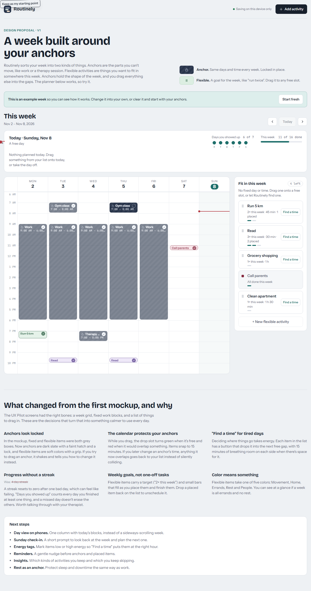
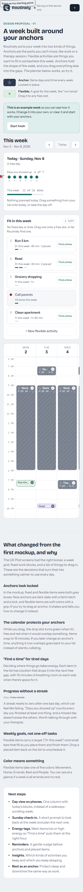

# Main Layout Specification

**Approved**: 2026-11-08 - user: "approoved"

## Problem Statement

The app still opens on the skeleton's status page; the planner exists only as a prototype artifact. Every later planner feature (anchors, placements, check-off, drag) needs the main view to exist and needs a shared set of components, or each feature will restyle raw HTML on its own. This feature builds that design system and draws the main view from it, matching the prototype, with an example week as data.

## Goals

- [ ] Opening `/` shows the planner laid out like the prototype captures at 1280 px and 390 px wide.
- [ ] App code outside `src/web/ui/` renders no raw interactive or text HTML element, and `npm run check` fails when it does.
- [ ] Every design-system component can be seen in each of its states in Storybook.

## Out of Scope

| Feature | Reason |
| --- | --- |
| Week navigation, check-off, drag and drop, Find a time, unplacing | User chose "Static layout only"; each comes in its own feature (AD-011) |
| The Add/Edit activity drawer | Behaviour feature; not part of a static layout |
| Anchors, activities and placements tables, API routes, persistence | User chose "Typed example week"; real data is a later feature |
| Saving states in the top bar ("Saving…", "Saved", "Not saved…") | Nothing saves in this feature |
| A theme toggle | The prototype follows the OS setting and has no toggle |
| Dark-mode reference captures | User chose "Port dark tokens, follow system" |
| Proposal intro, design notes, example-week banner | AD-010 |
| Phone day view | Out of scope for v1 (docs/product.md) |
| Building Storybook inside `npm run check` | AD-007 |

---

## Assumptions & Open Questions

| Assumption / decision | Chosen default | Rationale | Confirmed? |
| --- | --- | --- | --- |
| Raw elements banned outside `src/web/ui/` | `button`, `input`, `select`, `textarea`, `a`, `label`, `h1`-`h6`, `p`, `span`; enforced by ESLint | User request | y - user chose "Interactive + text (Recommended)" (AD-005) |
| Styling | CSS Modules + global `tokens.css` | Built into Vite, no new dependency | y - user chose "CSS Modules (Recommended)" (AD-005) |
| Accessible primitives | In-house, on native elements | Learning project | y - user chose "Build them ourselves (Recommended)" (AD-005) |
| Data shown | A typed example-week fixture in one file, dated relative to the current week, passed to the view as props | No data model yet | y - user chose "Typed example week (Recommended)" |
| Behaviour | Static: drawn for the current week; planner controls drawn disabled, not faded (Today faded as in the capture) | Each control's behaviour comes with its own feature | y - user chose "Static layout only", then "Draw them, disabled (Recommended)" (AD-011) |
| Routing | React Router; `/` planner, `/status` health page | Scales to more screens; the server already serves `index.html` for page paths | y - user chose "React Router (Recommended)" (AD-006) |
| Fonts | Self-hosted via `@fontsource` | Local network only | y - user chose "Self-host via @fontsource (Recommended)" (AD-009) |
| Icons | `lucide-react` behind `<Icon>` | The prototype's icons are Lucide-style; one place to swap the set | y - user chose "lucide-react behind our <Icon> (Recommended)" (AD-008) |
| Catalog | Storybook; stories typechecked and linted | Keeps `npm run check` fast | y - user chose "Storybook", "Typecheck + lint stories (Recommended)" (AD-007) |
| Widths held to captures | 1280×900 and 390×844, full-page | The prototype's two layouts: side by side, and stacked | y - user chose "1280 desktop + 390 phone (Recommended)" |
| Dark mode | Prototype's dark tokens ported; follows OS setting | Same as the prototype; no toggle exists there | y - user chose "Port dark tokens, follow system (Recommended)" |
| Top bar status slot | "Example week" with a grey dot | True while the view shows the fixture | y - user chose "\"Example week\" (Recommended)" |
| Who writes | The agent writes everything, then walks the user through it | Learning project | y - user: "you write, i will lean" |
| Example week content | Recreates the prototype's example: anchors Work (Mon–Fri 09:00–18:00), Gym class (Tue, Thu 07:00–08:00), Therapy session (Wed 19:00–20:00); flexible Run 5 km (Movement, 2×, 45 min), Read (Rest, 3×, 30 min), Grocery shopping (Errands, 1×, 1 h), Call parents (People, 1×, 30 min), Clean apartment (Home, 1×, 1 h 30 min); placements Run Mon 19:00, Read Tue and Thu 21:30, Call parents Sat 11:00; every item on a day before today is done, except Gym class on Thursday | Matches the captures | n |
| Cursors | Blocks and tray items use the default cursor (no grab / not-allowed) while nothing drags | A grab cursor promises a drag that does nothing | n |
| Clicking a block or tray item | Does nothing; blocks and tray items are not buttons in this feature | The drawer they open is out of scope | n |
| Now-line and "Now" pill refresh | Positioned from the clock and refreshed once a minute, as the prototype | Static data, live clock | n |
| Unknown paths | Redirect to `/` | No not-found page is designed | n |
| Time format | Follows the active language through `Intl`: English 12-hour ("7:00 – 8:00 AM", hour labels "6 AM"), pt-BR 24-hour ("07:00 – 08:00", hour labels "06:00") | CLAUDE.md: dates and times follow the active language | n |

**Open questions:** none - all resolved or logged above.

---

## User Stories

### P1: A design system app code must use ⭐ MVP

**User Story**: As the developer, I want a set of reusable components and a lint rule that forbids raw HTML controls and text outside them, so that every screen looks consistent and I learn to build with components.

**Why P1**: The main view and every later feature are built from it.

**Acceptance Criteria**:

1. IF a `.tsx` file outside `src/web/ui/` renders any of `button`, `input`, `select`, `textarea`, `a`, `label`, `h1`, `h2`, `h3`, `h4`, `h5`, `h6`, `p` or `span` THEN `npm run lint` SHALL exit non-zero and name the element.
2. WHEN a `.tsx` file inside `src/web/ui/` renders those elements THEN `npm run lint` SHALL report no error for them.
3. WHEN a `.tsx` file outside `src/web/ui/` renders `div`, `section`, `main`, `header`, `aside` or `nav` THEN `npm run lint` SHALL report no error for them.
4. The design system SHALL define every color, font and radius of the prototype's light and dark themes as CSS custom properties in one `tokens.css`, with the light values matching the prototype's `:root` values.
5. WHILE the operating system prefers a dark color scheme the app SHALL use the prototype's dark token values (e.g. page background `#0F131A`).
6. The design system SHALL have a Storybook story file for every component in `src/web/ui/`, with one story per variant and per state (including disabled where the component has one).
7. WHEN the app is built THEN the build SHALL include the Bricolage Grotesque, Instrument Sans and JetBrains Mono font files, and loading the app SHALL make no request to a host other than the app's own.
8. The design system's `Icon` component SHALL be the only module in `src/web` that imports `lucide-react`.
9. WHEN a design-system control is disabled THEN it SHALL carry the native `disabled` attribute and SHALL NOT receive focus from the Tab key.

**Independent Test**: Add a raw `<button>` to a fixture outside `src/web/ui/` and run lint (fails); open Storybook and see each component in each state.

---

### P1: See my week on the main view ⭐ MVP

**User Story**: As the owner, I want `/` to show my week like the prototype, so that the planner has its real shape before its features arrive.

**Why P1**: It's the screen every later planner feature fills in.

**Acceptance Criteria**:

1. WHEN the owner opens `/` in a 1280×900 window THEN the app SHALL show the main view in `.specs/features/0002-main-layout/captures/main--desktop.png`, with the differences listed in `## Differences from the source`.
2. WHEN the owner opens `/` in a 390×844 window THEN the app SHALL show the main view in `.specs/features/0002-main-layout/captures/main--phone.png` (tray above the grid, grid scrolling sideways, "Add activity" label hidden), with the differences listed in `## Differences from the source`.
3. The week header SHALL show "This week" and the range from the current week's Monday to its Sunday in the active language (English example: "Nov 2 – Nov 8, 2026").
4. The week grid SHALL show seven day columns starting Monday, each headed by the weekday and the day of the month, with hour rows from 06:00 to 23:00 labelled in the active language's time format.
5. The week grid SHALL mark today's column and circle today's day number in the accent color.
6. WHILE the current time is between 06:00 and 23:00 the week grid SHALL draw a line across today's column at the current time, in the accent color.
7. The week grid SHALL draw each anchor occurrence as a dark slate block with the hatch and a lock icon, positioned and sized by its start and end time, showing its name and time range.
8. The week grid SHALL draw each placement in its category's color (Movement sage, Home sky, Errands apricot, Rest lilac, People rose), positioned by its start time and sized by its activity's duration, showing its name and time range.
9. WHEN a block is shorter than 40 px THEN the week grid SHALL show only its name row, without the time range.
10. WHEN an anchor occurrence is done THEN the week grid SHALL draw it at reduced opacity with its round check filled.
11. WHEN a placement is done THEN the week grid SHALL strike through its name, draw it at reduced opacity and fill its round check.
12. The Today strip SHALL show "Today · " followed by today's weekday, month and day in the active language, and list today's anchor occurrences and placements in start-time order, each with a checkbox, its name, its time range and a dot in its category color (slate for anchors).
13. WHEN the current time falls within a Today-strip item THEN the Today strip SHALL show a "Now" pill on that item instead of its color dot.
14. WHEN today has no items THEN the Today strip SHALL show "A free day" under the heading and the text "Nothing planned today. Drag something from your list onto today, or take the day off."
15. WHEN today has items THEN the Today strip SHALL show "N of M done" under the heading, where N counts today's done items and M all of today's items.
16. The Today strip SHALL show "Days you showed up" with "N of 7" and seven day dots (M T W T F S S), filled for each day of the current week with at least one done item.
17. The Today strip SHALL show "This week" with "N of M done" and a meter filled to N/M, where M sums each anchor's repeat days and each flexible activity's times per week, and N sums done anchor occurrences plus, per flexible activity, its done placements capped at its times per week.
18. The tray SHALL show "Fit in this week", a count "N left" where N sums, per flexible activity, its times per week minus its placements this week (not below 0), and the hint "No fixed day or time. Drag one onto a free slot, or let Routinely find one."
19. The tray SHALL list each flexible activity with its name, "N× this week · <duration>" (plus " · K placed" when K > 0), one pip per time per week (accent for done, grey for placed, empty for the rest), and a "Find a time" button.
20. WHEN every time of a flexible activity is placed THEN the tray SHALL show it with its category-color swatch instead of the grip, without "Find a time", and with the text "All done this week" when all its placements are done, otherwise "All placed this week".
21. The tray SHALL end with a "+ New flexible activity" button.
22. The top bar SHALL show the Routinely mark and name, the status text "Example week" with a grey dot, an "Add activity" button with a plus icon, and the language switch.
23. The main view SHALL draw the week arrows, Today, Add activity, Find a time, + New flexible activity, the checkboxes, the round checks and the move-back-to-list button disabled (AD-011).
24. The app SHALL style nothing undone with red, warning icons or alert colors, and SHALL use no undone wording (missed, failed, overdue, late, skipped) in either language.
25. Every text on the main view SHALL come from `src/web/i18n/en.json` and `src/web/i18n/pt-BR.json`, except activity names from the data.
26. WHEN the owner picks Português in the top bar THEN the main view SHALL show its texts, dates and times in pt-BR.
27. WHILE the window is 390 px or 1280 px wide the page SHALL have no horizontal scroll; at 390 px the week grid scrolls sideways inside its card.

**Independent Test**: Open `/` at 1280 and 390 px and compare with the captures; switch to Português and see the texts, dates and 24-hour times change.

---

### P1: The status page keeps working at `/status` ⭐ MVP

**User Story**: As the owner, I want the health check at `/status`, under the same top bar, so that I can still see whether the server and database answer.

**Why P1**: Moving `/` to the planner must not lose the skeleton's health check.

**Acceptance Criteria**:

1. WHEN the owner opens `/status` THEN the app SHALL show the top bar and, below it, the status card with the server and database lines and the checked-at time, as today.
2. WHEN the owner opens a path that is neither `/` nor `/status` THEN the app SHALL show the main view at `/`.
3. WHEN the owner picks a language on any page and reloads THEN the app SHALL keep that language, as today.

**Independent Test**: Open `/status` and see "Server: connected" and "Database: connected" under the top bar.

---

## Edge Cases

- IF the current time is before 06:00 or after 23:00 THEN the week grid SHALL draw no now-line.
- WHEN an anchor starts before 06:00 or ends after 23:00 THEN the week grid SHALL clip its block to the grid's hours.
- WHEN an activity name is longer than its block or row THEN the app SHALL cut it with an ellipsis on one line.
- WHEN the flexible-activity list is empty THEN the tray SHALL show "Nothing here yet. Add something you'd like to fit into your week." and "0 left".

---

## Requirement Traceability

| Requirement ID | Story | Phase | Status |
| --- | --- | --- | --- |
| DS-01 | P1: Design system - raw element banned outside `ui/` | Design | Pending |
| DS-02 | P1: Design system - allowed inside `ui/` | Design | Pending |
| DS-03 | P1: Design system - structural elements allowed | Design | Pending |
| DS-04 | P1: Design system - tokens | Design | Pending |
| DS-05 | P1: Design system - dark tokens | Design | Pending |
| DS-06 | P1: Design system - stories | Execute | In progress (T4, T5, T6, T7, T8, T9, T10) |
| DS-07 | P1: Design system - self-hosted fonts | Design | Pending |
| DS-08 | P1: Design system - Icon wraps lucide | Execute | Implemented (T4) |
| DS-09 | P1: Design system - disabled controls | Execute | In progress (T9, T10, T11) |
| MAIN-01 | P1: Main view - desktop capture | Design | Pending |
| MAIN-02 | P1: Main view - phone capture | Design | Pending |
| MAIN-03 | P1: Main view - week header | Execute | In progress (T35) |
| MAIN-04 | P1: Main view - grid days and hours | Execute | In progress (T35) |
| MAIN-05 | P1: Main view - today column | Execute | In progress (T33) |
| MAIN-06 | P1: Main view - now-line | Execute | In progress (T33) |
| MAIN-07 | P1: Main view - anchor blocks | Execute | In progress (T32) |
| MAIN-08 | P1: Main view - placement blocks | Execute | In progress (T32) |
| MAIN-09 | P1: Main view - tiny blocks | Execute | In progress (T32) |
| MAIN-10 | P1: Main view - done anchor | Execute | In progress (T32) |
| MAIN-11 | P1: Main view - done placement | Execute | In progress (T32) |
| MAIN-12 | P1: Main view - Today list | Execute | In progress (T35) |
| MAIN-13 | P1: Main view - Now pill | Execute | In progress (T35) |
| MAIN-14 | P1: Main view - free day | Execute | In progress (T31) |
| MAIN-15 | P1: Main view - today count | Execute | In progress (T31) |
| MAIN-16 | P1: Main view - days you showed up | Execute | In progress (T31) |
| MAIN-17 | P1: Main view - week done meter | Execute | In progress (T31) |
| MAIN-18 | P1: Main view - tray header | Execute | In progress (T34) |
| MAIN-19 | P1: Main view - tray items | Execute | In progress (T34) |
| MAIN-20 | P1: Main view - fully placed items | Execute | In progress (T34) |
| MAIN-21 | P1: Main view - new flexible button | Execute | In progress (T34) |
| MAIN-22 | P1: Main view - top bar | Execute | In progress (T29) |
| MAIN-23 | P1: Main view - disabled controls | Execute | In progress (T35) |
| MAIN-24 | P1: Main view - no undone shaming | Design | Pending |
| MAIN-25 | P1: Main view - i18n texts | Execute | In progress (T35) |
| MAIN-26 | P1: Main view - pt-BR | Execute | In progress (T26) |
| MAIN-27 | P1: Main view - no horizontal scroll | Design | Pending |
| MAIN-28 | Edge: no now-line outside hours | Execute | In progress (T25) |
| MAIN-29 | Edge: anchor clipped to hours | Execute | In progress (T25) |
| MAIN-30 | Edge: long names ellipsis | Execute | In progress (T5) |
| MAIN-31 | Edge: empty tray | Execute | In progress (T34) |
| STATUS-01 | P1: Status page - `/status` | Design | Pending |
| STATUS-02 | P1: Status page - unknown paths | Design | Pending |
| STATUS-03 | P1: Status page - language kept | Design | Pending |

**Coverage:** 43 total, 0 mapped to tasks, 43 unmapped (tasks not written yet)

---

## Differences from the source

| Source shows | Product shows | Confirmed |
| --- | --- | --- |
| Proposal intro: "Design proposal · v1", "A week built around your anchors", paragraph, Anchor/Flexible legend | Nothing | y - AD-010 |
| "This is an example week" banner with Start fresh and Keep as my starting point (the latter floating at the top-left corner) | Nothing | y - AD-010 |
| "What changed from the first mockup, and why" notes and Next steps | Nothing | y - AD-010 |
| Week arrows, Add activity, Find a time, + New flexible activity, checkboxes and round checks enabled | The same controls, same look, disabled | y - AD-011 |
| Top bar status reads "Saving on this device only" with a green dot | "Example week" with a grey dot (the prototype's text before it loads storage) | y - AD-016 |
| No language switch | Language switch on the right of the top bar | y - AD-012 |
| Red current-time line with a red dot | Accent-colored line and dot | y - AD-013 |
| Red dot and line at the left of the "Days you showed up" row | Nothing there | y - AD-014 |

## Sources

- `docs/product.md` - concepts, design principles, the rule against making the user feel bad
- Prototype artifact `https://claude.ai/artifact/T8Le5wkuVSNmu22m6qpHeD` - the design both captures come from
- `.specs/features/0002-main-layout/context.md` - every decision and the user's words
-  - binding - the prototype page at 1280 px wide, full page, light theme, Sunday 2026-11-08: top bar, week header, Today strip, week grid beside the tray
-  - binding - the prototype page at 390 px wide, full page, light theme: tray above the grid, grid scrolling sideways, Add activity as an icon

---

## Success Criteria

- [ ] The screens sub-agent judges both running pictures `matches` against their captures.
- [ ] `npm run check` and `npm run e2e` exit 0, and a raw `<button>` outside `src/web/ui/` makes `npm run check` fail.
