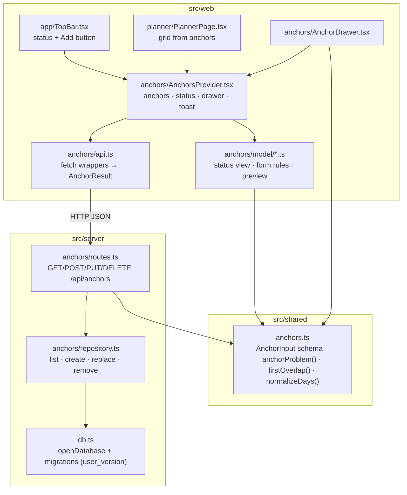

# Anchors Design

**Spec**: `.specs/features/0004-anchors/spec.md`
**Status**: Approved

---

## Architecture Overview

The anchor rules live once, in `src/shared/anchors.ts`, as pure functions that both the drawer and the API call. The server stores anchors in one SQLite table behind a small repository written in plain SQL (AD-021). The web app holds the loaded anchors, the save status, the drawer and the toast in one React context, `AnchorsProvider`. It sits above both the top bar and the planner, because the top bar's + button and status slot both need it. The drawer is a design-system `Drawer` on the native `<dialog>` (AD-022).



### Flow of a save

1. The drawer turns the form into an `AnchorDraft` and runs `formProblem(draft, anchors, editingId)`, which wraps the shared `anchorProblem`. A problem shows its message, nothing is sent and the status does not change (ANC-26…36).
2. Otherwise the provider sets the status to `saving`, disables Save and calls `POST` or `PUT`.
3. The server parses the body, runs the same `anchorProblem` against the stored anchors (minus the anchor's own row on `PUT`), and writes. `node:sqlite` is synchronous, so the read, check and write in one request run with no `await` between them, and no other request can slip in (ANC-07, two tabs).
4. The provider maps the result: `ok` puts the stored anchor in place, closes the drawer, shows the toast and sets `saved`. `rule` (400/409) shows the message in the drawer. `notFound` closes the drawer, reloads and shows the toast. `failed` shows the "Not saved" line and sets `notSaved`.

---

## Code Reuse Analysis

### Existing Components to Leverage

| Component | Location | How to Use |
| --- | --- | --- |
| `Anchor`, `DayIndex`, `Minutes`, `PlannerData` | `src/shared/planner.ts` | `Anchor` is the API and stored shape as is; the planner builds `PlannerData` from loaded anchors with empty activities, placements and done marks |
| `itemsForDay`, `daysShowedUp`, `weekProgress`, `trayItems`, `trayLeft` | `src/web/planner/model/` | Unchanged; fed the anchors-only `PlannerData` (ANC-11) |
| `blockGeometry` clipping | `src/web/planner/model/grid.ts` | Already clips blocks to 06:00–23:00 (ANC-44) |
| `formatTimeRange`, `formatWeekday` | `src/web/planner/model/format.ts` | Preview time range; a new `formatWeekdayIndex` builds on `formatWeekday` |
| `StatusIndicator` (`neutral`/`ok`/`busy`/`error`) | `src/web/ui/StatusIndicator/` | Top bar status; the tones already match the spec's dots |
| `Button` (`pressed`, `variant`, `disabled`) | `src/web/ui/Button/` | Day toggles (`pressed`), Save, Cancel, close, and the + button (drops `inert`) |
| `Text tone="error"` | `src/web/ui/Text/` | Only the "Not saved" / "Not deleted" lines |
| `useHealth` pattern (abort, `ignore` flag) | `src/web/health/useHealth.ts` | Same guard for the load request under StrictMode |
| `buildApp({ db })` + `app.inject()` | `src/server/app.ts`, `routes/health.test.ts` | Route tests inject against a real temp-file database |
| Child-process server test | `src/server/index.test.ts` | Restart test for ANC-08 |
| zod | dependency, `src/shared/health.ts` | Shape parsing of request bodies and responses |

### Integration Points

| System | Integration Method |
| --- | --- |
| Fastify app | `buildApp` calls `registerAnchorRoutes(app, deps.db.anchors)` next to the health route |
| SQLite | `openDatabase` runs the migration list before returning; `Database` gains an `anchors: AnchorRepository` member |
| `App.tsx` | Wraps `TopBar` and `Routes` in `AnchorsProvider` and renders `AnchorDrawer` and `Toast` once |
| `GridBlock` | Anchor blocks get a `CoverButton` sibling that opens the drawer |
| e2e | Tests reset anchors through the API before each test; Playwright runs one worker (AD-024) |

---

## Components

### Shared anchor rules

- **Purpose**: Define what a valid anchor is, once, for the drawer and the API.
- **Location**: `src/shared/anchors.ts`
- **Interfaces**:
  - `AnchorInput` (zod): `{ name: string, days: number[], start: number | null, end: number | null }`. Only the shape is checked here: types, integer weekdays 0–6, and integer or null times. A body that fails the shape answers 400 `{ code: "invalid" }`.
  - `type ProblemCode = "nameEmpty" | "nameTooLong" | "noDays" | "timesMissing" | "timeStep" | "endBeforeStart"`
  - `type AnchorProblem = { code: ProblemCode } | { code: "overlap"; other: string; day: DayIndex }`
  - `anchorProblem(input: AnchorInput, others: Anchor[]): AnchorProblem | null`. Checks in the spec's order and returns the first problem. Name is trimmed, 1–60 characters. Times are integers from 0 to 1425 (23:45) and multiples of 15. End is after start. Overlap is the first other anchor sharing a day in week order where `a.start < b.end && b.start < a.end`, so touching is allowed.
  - `normalizeAnchor(input): Omit<Anchor, "id">`: trims the name and sorts and de-duplicates days (ANC-09).
  - `MAX_NAME = 60`, `STEP = 15`, `LAST_START = 1425`
- **Dependencies**: zod, `planner.ts` types
- **Reuses**: the `Anchor` type

### Database and migrations

- **Purpose**: Open the file, bring the schema up to date and expose the anchors repository.
- **Location**: `src/server/db.ts`, `src/server/migrations.ts`
- **Interfaces**:
  - `migrations: string[]`: SQL steps in order. Step _n_ moves `PRAGMA user_version` from _n_ to _n_+1 inside one transaction.
  - `migrate(sqlite: DatabaseSync): void`
  - `Database` gains `anchors: AnchorRepository`; `ping` and `close` stay.
- **Reuses**: the existing `openDatabase` (mkdir and the open-failure path stay as they are)

### Anchor repository

- **Purpose**: Plain-SQL reads and writes of the `anchors` table.
- **Location**: `src/server/anchors/repository.ts`
- **Interfaces**:
  - `list(): Anchor[]`, ordered by `start`, then `name`
  - `get(id): Anchor | undefined`
  - `create(anchor: Omit<Anchor, "id">): Anchor`, id from `crypto.randomUUID()`
  - `replace(id, anchor): Anchor | undefined`, `undefined` when the id is not stored
  - `remove(id): boolean`
- **Dependencies**: `DatabaseSync`

### Anchor routes

- **Purpose**: The HTTP API from ANC-01…09.
- **Location**: `src/server/anchors/routes.ts`
- **Interfaces**:
  - `GET /api/anchors` → 200 `Anchor[]`
  - `POST /api/anchors` → 201 `Anchor` | 400 `{ code }` | 409 `{ code: "overlap", other, day }`
  - `PUT /api/anchors/:id` → 200 `Anchor` | 400 | 404 `{ code: "notFound" }` | 409
  - `DELETE /api/anchors/:id` → 204 | 404 `{ code: "notFound" }`
  - The order on `PUT` is 404 first, then 400, then 409, so an unknown id never reports a rule.
- **Dependencies**: repository, shared rules
- **Reuses**: the health route's register-function pattern

### Web API client

- **Purpose**: Turn fetches into typed results so nothing above it handles raw responses.
- **Location**: `src/web/anchors/api.ts`
- **Interfaces**:
  - `loadAnchors(signal): Promise<Anchor[] | "failed">`
  - `saveAnchor(id: string | null, body: AnchorInput): Promise<SaveResult>`
  - `deleteAnchor(id): Promise<DeleteResult>`
  - `SaveResult = { kind: "ok"; anchor } | { kind: "rule"; problem: AnchorProblem } | { kind: "notFound" } | { kind: "failed" }`
  - `DeleteResult = { kind: "ok" } | { kind: "notFound" } | { kind: "failed" }`
  - Every status maps to a result (lesson L-004). 200/201 with a body that passes the schema is `ok`, 400/409 with a known code is `rule`, 404 is `notFound`, and anything else is `failed`: other statuses, a network error, a non-JSON body, or a body that fails the schema.

### Status and form models (pure)

- **Location**: `src/web/anchors/model/`
- **Interfaces**:
  - `saveStatus.ts`: `type SaveStatus = "loading" | "loadFailed" | "saved" | "saving" | "notSaved"`; `statusView(s): { tone: StatusTone; key: string }` (ANC-12, 13, 14, 20, 21, 22, 41).
  - `form.ts`: `type AnchorDraft = { name: string; days: DayIndex[]; start: string; end: string }` (time strings `"HH:MM"` or `""` as the native input gives them); `newDraft()` (Mon–Fri, 09:00–18:00); `draftFromAnchor(a)`; `draftToInput(d): AnchorInput`; `formProblem(d, anchors, editingId): AnchorProblem | null`, which excludes `editingId` from `others` (ANC-35).
  - `messages.ts`: `problemMessage(p, lang): { key; values }`. The overlap day goes through `formatWeekdayIndex`; the 15-minute examples are 540 and 555 formatted for the language (ANC-30).
  - `preview.ts`: `daysLabel(days, lang): { key; values }`. The keys are `everyDay` (all 7), `weekdays` (exactly 1–5, rendered "Mon–Fri" from the language's short names), `weekends` (exactly 0 and 6), or `list` (short names in week order joined with ", "). `previewParts(draft, lang)` handles "Untitled" and the time range. A draft whose times are empty or invalid shows no time range.
  - `minutesFromTime("HH:MM") / timeFromMinutes(m)`.
- **Reuses**: `formatTimeRange`, `formatWeekday`

### AnchorsProvider

- **Purpose**: The one place that owns the anchor list, status, drawer state and toast.
- **Location**: `src/web/anchors/AnchorsProvider.tsx`, `useAnchors()`
- **Interfaces** (context value):
  - `anchors: Anchor[]`, `status: SaveStatus`
  - `drawer: { mode: "closed" } | { mode: "add" } | { mode: "edit"; anchor: Anchor }`
  - `openAdd()`, `openEdit(id)`, `closeDrawer()`
  - `save(draft): Promise<DrawerOutcome>` and `remove(): Promise<DrawerOutcome>`, where `DrawerOutcome = { kind: "closed" } | { kind: "message"; problem | failure }`. The drawer shows any message it gets back.
  - `toast: { id: number; text: string } | null`
- **Behaviour**: loads once on mount, with an `ignore` guard for StrictMode as in `useHealth`. No retry (spec Assumptions). Only the latest request's result is applied. After a 404 it calls `loadAnchors` again and replaces the list. Toasts are given an increasing id so the same text twice restarts the 3.4 s timer.

### Drawer (design system)

- **Purpose**: A modal right-side panel.
- **Location**: `src/web/ui/Drawer/`
- **Interfaces**: `<Drawer open title onClose footer>{children}</Drawer>`
- **Behaviour**: calls `showModal()` when `open` turns true and `close()` when it turns false. The browser provides the focus trap, the inert page, Escape (handled through the `cancel` event, which calls `onClose`) and the backdrop. A click on the `::backdrop` (target is the dialog element itself) calls `onClose`. It remembers `document.activeElement` on open and focuses it on close. If that element has left the DOM (a deleted anchor's block), it focuses the top bar's + button instead, through a `returnFocusFallback` ref. Width `min(440px, 100%)`, full height, footer pinned so it stays visible at 390 px (ANC-47).
- **jsdom**: `test-setup.ts` stubs `HTMLDialogElement.prototype.showModal/close` to toggle `open` and fire `close`. Real focus behaviour (ANC-24, 25) is asserted in Playwright.

### Form fields (design system)

- `src/web/ui/TextField/`: label plus `input`, with `maxLength` (ANC-27) and a `ref` for focus (ANC-16, 26).
- `src/web/ui/TimeField/`: label plus `input type="time" step={900}`, with a `"HH:MM"` value.
- `src/web/ui/FieldGroup/`: a `fieldset`/`legend` for "Repeats on"; its toggles are `Button pressed size="sm"`.
- `src/web/ui/MessageLine/`: `role="status"` + `aria-live="polite"`, always mounted so changes are announced (ANC-36). Rule messages use `tone="muted"` with an info icon. Only the failure messages use `tone="error"`.
- `src/web/ui/Toast/`: a fixed, bottom-centred, `role="status"` toast.
- `src/web/ui/CoverButton/`: an invisible button stretched over its positioned parent, with an accessible name. Enter and Space work natively (ANC-17).

### AnchorDrawer

- **Purpose**: The add/edit form.
- **Location**: `src/web/anchors/AnchorDrawer.tsx`
- **Behaviour**: local `draft`, `message` and `armed` state, reset whenever the drawer opens (ANC-40). The title is "Add anchor" or "Edit anchor". Delete is shown only in edit mode. The first click arms it (`variant="danger"`, label "Click again to delete"); the second calls `remove()`. Save is `disabled` while `status === "saving"`. Labels, the preview and the message are rendered from `{ key, values }` at render time, so a language change re-renders them (ANC-46).

### Planner and top bar changes

- `PlannerPage`: `data = { anchors, activities: [], placements: [], doneAnchors: [], donePlacementIds: [] }` from `useAnchors()`. `exampleWeek.ts` and its test are deleted. Anchor grid blocks carry `anchorId`.
- `GridBlock`: an anchor block renders `<CoverButton label={t("grid.editAnchor", { name })} onClick={() => onOpen(anchorId)} />` under its content. The lock, name and time stay `pointer-events: none` so a click anywhere on the block lands on the cover. The inert `CheckToggle` sits above it.
- `TopBar`: the status comes from `statusView(status)` and the + button loses `inert` and calls `openAdd()`. The `topBar.exampleWeek` key is removed (AD-023).

---

## Data Models

### SQLite (migration 1)

```sql
CREATE TABLE anchors (
  id    TEXT PRIMARY KEY,
  name  TEXT NOT NULL,
  days  TEXT NOT NULL,   -- JSON array of weekdays, ascending, unique: "[1,2,3,4,5]"
  start INTEGER NOT NULL, -- minutes since midnight
  "end" INTEGER NOT NULL
) STRICT;
```

Days are a JSON array, not a join table. The repository reads and writes the whole anchor at once, and the overlap check runs in TypeScript over every anchor, so a join table would add writes without adding any query.

### API

```typescript
// Response and stored shape: the existing Anchor in src/shared/planner.ts
interface Anchor { id: string; name: string; days: DayIndex[]; start: Minutes; end: Minutes }

// Request body for POST and PUT
type AnchorInput = { name: string; days: number[]; start: number | null; end: number | null }

// Error bodies
type RuleError = { code: ProblemCode } | { code: "overlap"; other: string; day: DayIndex }
type OtherError = { code: "invalid" } | { code: "notFound" }
```

---

## Error Handling Strategy

| Error Scenario | Handling | User Impact |
| --- | --- | --- |
| Rule broken in the drawer | `formProblem` before any request | Calm muted message; status unchanged; drawer open |
| 400/409 from the server (another tab, or a rule the drawer missed) | `rule` result → same message | Same as above; status returns to what it was before `saving` |
| 404 on save or delete | Close, reload the list, show the toast | "That anchor was already deleted." |
| 5xx, network error, bad body on save | `failed` | Drawer keeps the values; "Not saved. …" in red; status "Not saved" (red dot) |
| Same on delete | `failed` | "Not deleted. Try again in a moment." in red; status "Not saved" |
| Load fails | `loadFailed`, empty list | "Couldn't load your week" (red dot); grid empty, + still works |
| Malformed body sent to the API | 400 `{ code: "invalid" }` | API callers only; the drawer always sends the shape |
| Migration fails at startup | Thrown from `openDatabase`, caught by the existing "Can't open the database at …" path | Server exits 1 with the path |

After a rule result the status goes back to the value it had before `saving`, because ANC-34 says a rule message leaves the status unchanged.

---

## Risks & Concerns

| Concern | Location (file:line) | Impact | Mitigation |
| --- | --- | --- | --- |
| e2e shares one database file across runs and workers | `playwright.config.ts:22` | Anchors from one test or an earlier run leak into another; with parallel workers, two files race on the same table | Playwright runs `workers: 1`; a helper deletes every anchor through the API in `beforeEach` (AD-024) |
| e2e tests assert the example week (Therapy session, tray overflow at 1280×800, 09:00–18:00 times, "Semana de exemplo") | `e2e/main.spec.ts:96`, `:271`, `:300` | They fail once the example is gone | Those tests seed anchors through the API. The tray-overflow check is dropped, since there are no flexible activities to overflow; it comes back with flexible activities. "Semana de exemplo" becomes the loaded status text |
| `shows no error red` scans the whole page | `e2e/main.spec.ts:225` | Still valid (no error is shown there); the armed Delete is red by design | A separate e2e test confirms the drawer's rule messages are not red |
| jsdom has no `showModal` | `node_modules/jsdom/.../HTMLDialogElement-impl.js` | Component tests can't prove the focus trap | Stub in `test-setup.ts`; ANC-24/25 are proven in Playwright |
| Nested interactive elements if the block itself became a button | `src/web/planner/components/GridBlock.tsx:66` | A button inside a button is invalid HTML, and screen readers misread it | `CoverButton` is a sibling under the content, not a wrapper |
| Focus return target removed after delete | Drawer | Focus would fall to `body` | Fall back to the + button |
| `GET` order by name uses SQLite's binary collation; the planner sorts with `localeCompare` | repository / `schedule.ts:58` | "Ana" vs "ana" order may differ between the API and the grid | ANC-01 only fixes start, then name; the API sorts with `ORDER BY start, name COLLATE NOCASE`, and the grid keeps its own sort |
| `openDatabase` gains migrations, the first schema code | `src/server/db.ts:11` | A failing step could leave a half-migrated file | Each step runs in `BEGIN`/`COMMIT` with its `user_version` bump; tested against a fresh file and an already-migrated one |

---

## Tech Decisions

| Decision | Choice | Rationale |
| --- | --- | --- |
| Days column | JSON text | Whole-row reads and writes; the overlap check runs in TypeScript |
| Body validation | zod shape + shared `anchorProblem` | One rule function for both sides; zod is already a dependency |
| Rule check vs shape check | Shape failures answer `invalid`; rule failures answer the rule's code | The drawer always sends the right shape; the codes the spec names are the rules |
| Concurrency | Synchronous read-check-write in one handler | `node:sqlite` is synchronous and Node is single-threaded, so there is no gap between the check and the write |
| Client state | React context, hand-written fetches | ADR-001: data fetching is built by hand; one provider because the top bar and planner share it |
| Anchor block activation | `CoverButton` sibling | Valid HTML next to the check toggle; native Enter and Space |
| Rule message color | Muted with an info icon; red only for failed save or delete | Spec success criterion: red only for real failures and the armed Delete |
| Armed Delete | New `Button variant="danger"` | Red is the destructive-action color, not an undone item |

Project-level decisions logged in `STATE.md`: AD-021 (plain SQL and migrations), AD-022 (modals on native `<dialog>`), AD-023 (top bar status reflects the save state; supersedes AD-016), AD-024 (e2e on one worker with an API reset).
