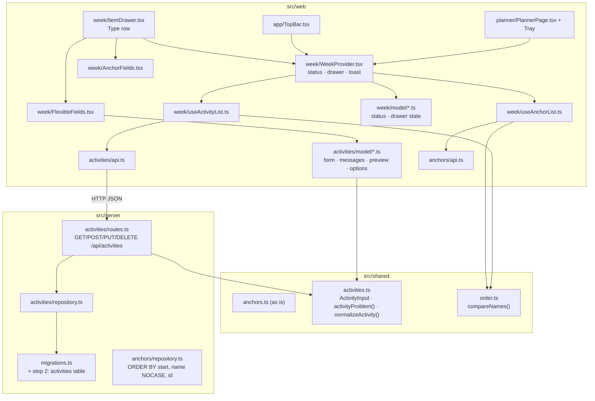

# Flexible Activities Design

**Spec**: `.specs/features/0005-flexible-activities/spec.md`
**Status**: Draft

---

## Architecture Overview

Flexible activities follow the anchors' layout end to end. Their rules live once in `src/shared/activities.ts` and both the drawer and the API call them. The server stores them in a second table behind a plain-SQL repository (AD-021), reached at `/api/activities`.

On the web side, `AnchorsProvider` becomes `WeekProvider` in `src/web/week/` (user chose "One week provider (Recommended)"). It owns what the two kinds of item share: the top bar status, the drawer state and the toast. Each kind's list, with its load, save and delete, sits in its own hook: `useAnchorList` (the code that is in `AnchorsProvider` today) and `useActivityList` (new). One `ItemDrawer` replaces `AnchorDrawer`. It shows the Type row when adding, then either `AnchorFields` or `FlexibleFields`. Each kind keeps its `api.ts` and pure `model/` folder.

A shared `compareNames` puts names in the same order as SQLite's `COLLATE NOCASE`, so the lists the browser sorts after a save match what `GET` returns (FLX-50, FLX-51).



### Flow of a save (flexible)

1. `ItemDrawer` runs `activityFormProblem(draft)`, which wraps the shared `activityProblem`. A problem shows its message, nothing is sent and the status does not change (FLX-38 to FLX-44).
2. Otherwise `WeekProvider.saveActivity(draft)` sets the status to `saving`, so Save is disabled, and calls `POST` or `PUT`.
3. The server parses the body, runs the same `activityProblem`, and writes. Activities have no overlap rule, so there is no 409.
4. The result is handled as for anchors. `ok` puts the stored activity in place, sorted with `compareNames`, closes the drawer, shows "Saved {name}." and sets `saved`. `rule` shows the message. `notFound` closes the drawer, reloads the activities and shows "That activity was already deleted.". `failed` shows the "Not saved" line and sets `notSaved`.

### Loading

The provider starts both loads on mount. The pure `afterLoads(anchors, activities)` turns the two results into one status: `loading` while either is pending, `loadFailed` if either failed, otherwise `saved` (FLX-15 to FLX-17). A list whose load failed stays empty. After a 404, only that kind's list reloads. The status goes back to `loading` and is then computed by `afterLoads` from the new result and the other list's last result.

---

## Code Reuse Analysis

### Existing Components to Leverage

| Component | Location | How to Use |
| --- | --- | --- |
| `FlexibleActivity`, `Category` | `src/shared/planner.ts` | The API and stored shape as is |
| `trayItems`, `trayLeft`, `weekProgress` | `src/web/planner/model/` | Unchanged; they already count `timesPerWeek` (FLX-12, FLX-13). The planner now feeds them the loaded activities |
| `durationParts` + `duration.*` keys | `src/web/planner/model/format.ts`, i18n | Duration in the tray, the select options and the preview (FLX-10, FLX-27, FLX-29) |
| `Tray` component | `src/web/planner/components/Tray.tsx` | Gains `onOpen`, `onAdd` and a category-tinted grip; the "+ New flexible activity" button loses `inert` |
| `CoverButton` | `src/web/ui/CoverButton/` | Makes a tray item open the drawer without wrapping the inert "Find a time" button (FLX-30) |
| `categoryTones`, `Swatch` | `src/web/ui/Swatch/` | Category colors for the tray grip and the Kind chips (FLX-11, FLX-28) |
| `Drawer`, `TextField`, `FieldGroup`, `MessageLine`, `Toast`, `Button` (`danger`, `inert`) | `src/web/ui/` | The drawer shell, Name, the message line, the toast, two-click Delete, the inert Find a time |
| Anchor API client pattern (`SaveResult`, `DeleteResult`, every status mapped) | `src/web/anchors/api.ts` | Copied in shape for `activities/api.ts` |
| Anchor repository and routes | `src/server/anchors/` | Same structure for the activities ones; same order of checks on `PUT` (404, then 400) |
| `migrate` | `src/server/migrations.ts` | Step 2 appended |
| `resetAnchors` | `e2e/anchors.ts` | A matching `resetActivities` in `e2e/activities.ts` (AD-024) |
| Child-process restart test | `src/server/index.test.ts` | Extended for FLX-07 |

### Integration Points

| System | Integration Method |
| --- | --- |
| Fastify app | `buildApp` calls `registerActivityRoutes(app, deps.db.activities)` |
| SQLite | `Database` gains `activities: ActivityRepository`; migration step 2 creates the table |
| `App.tsx` | `WeekProvider` replaces `AnchorsProvider`; `ItemDrawer` replaces `AnchorDrawer`; the toast reads `useWeek()` |
| `TopBar` | `useWeek()`: `status` and `openAdd("anchor")` |
| `PlannerPage` | `useWeek()`: `anchors`, `activities`, `openEditAnchor`, `openEditActivity`, `openAdd("flexible")` |

---

## Components

### Shared activity rules

- **Purpose**: Define what a valid flexible activity is, once, for the drawer and the API.
- **Location**: `src/shared/activities.ts`
- **Interfaces**:
  - `ActivityInput` (zod): `{ name: string, category: string, timesPerWeek: number, duration: number }`. Only the shape is checked. A body that fails the shape answers 400 `{ code: "invalid" }`, as for anchors.
  - `type ActivityProblemCode = "nameEmpty" | "nameTooLong" | "timesOutOfRange" | "durationNotAllowed" | "categoryUnknown"`
  - `activityProblem(input): { code: ActivityProblemCode } | null`. Checks in the order name, times, duration, category (FLX-44). Name: trimmed, 1–`MAX_NAME` characters (`MAX_NAME` is imported from `anchors.ts`). Times: an integer from `MIN_TIMES` 1 to `MAX_TIMES` 14. Duration: one of `DURATIONS = [15, 30, 45, 60, 90, 120, 180]`. Category: one of `CATEGORIES = ["movement", "home", "errands", "rest", "people"]`.
  - `normalizeActivity(input): Omit<FlexibleActivity, "id">`: trims the name and narrows the category type.
- **Reuses**: `MAX_NAME`, `Category`, `FlexibleActivity`

### Shared name order

- **Purpose**: The one definition of how names sort, matching SQLite's `NOCASE`.
- **Location**: `src/shared/order.ts`
- **Interfaces**:
  - `compareNames(a: string, b: string): number`. It folds only ASCII `A`–`Z` to lowercase, as `NOCASE` does, then compares the strings by code unit.
  - `compareAnchors(a, b)`: start, then `compareNames`, then id.
  - `compareActivities(a, b)`: `compareNames`, then id.
- **Tested against SQLite**: a server test inserts names that differ in case, accents and digits and checks that `list()` equals the same rows sorted with the shared comparator (FLX-01, FLX-50, FLX-51).

### Activity repository and routes

- **Location**: `src/server/activities/repository.ts`, `src/server/activities/routes.ts`
- **Repository**: `list()` (`ORDER BY name COLLATE NOCASE, id`), `get(id)`, `create(a)` (id from `crypto.randomUUID()`), `replace(id, a)`, `remove(id)`.
- **Routes**:
  - `GET /api/activities` → 200 `FlexibleActivity[]`
  - `POST /api/activities` → 201 | 400 `{ code }`
  - `PUT /api/activities/:id` → 200 | 404 `{ code: "notFound" }` | 400. The 404 check runs first.
  - `DELETE /api/activities/:id` → 204 | 404
- **Anchor repository change**: `ORDER BY start, name COLLATE NOCASE, id` (FLX-50).

### Week model (pure)

- **Location**: `src/web/week/model/`
- **Interfaces**:
  - `saveStatus.ts`: moved from `anchors/model/`, keys now `week.status.*`. It adds `type LoadResult = "pending" | "ok" | "failed"` and `afterLoads(anchors: LoadResult, activities: LoadResult): SaveStatus`.
  - `drawer.ts`: `type DrawerState = { mode: "closed" } | { mode: "add"; type: ItemType } | { mode: "editAnchor"; anchor: Anchor } | { mode: "editActivity"; activity: FlexibleActivity }`, `type ItemType = "anchor" | "flexible"`. Also `drawerTitleKey(state)`: "Add activity", "Edit anchor" or "Edit activity" (FLX-19, FLX-20, FLX-30, FLX-31). And `showsTypeRow(state)`, true only for `add` (FLX-21).

### Activity form model (pure)

- **Location**: `src/web/activities/model/`
- **Interfaces**:
  - `form.ts`: `type ActivityDraft = { name: string; timesPerWeek: number; duration: number; category: Category }`. `newActivityDraft()` gives `{ "", 1, 30, "movement" }` (FLX-19). `draftFromActivity(a)`, `activityDraftToInput(d)`, `activityFormProblem(d)`. `stepTimes(d, +1 | -1)` clamps to 1–14. `canStep(d)` returns `{ down: boolean; up: boolean }` (FLX-25, FLX-26).
  - `options.ts`: `durationOptions(): { minutes; key; values }[]` from `DURATIONS` and `durationParts`. `categoryOptions(): { category; key }[]` in the order Movement, Home, Errands, Rest, People (FLX-27, FLX-28).
  - `preview.ts`: `activityPreviewParts(draft)`: `{name|untitled}`, `"{times}× a week"`, `"{duration} each"`, `{category}` (FLX-29).
  - `messages.ts`: `activityProblemMessage(p)`. `nameEmpty` and `nameTooLong` use the same text as anchors.

### WeekProvider

- **Purpose**: The one place that owns both lists, the status, the drawer state and the toast.
- **Location**: `src/web/week/WeekProvider.tsx`, `useWeek()`
- **Context value**: `anchors`, `activities`, `status`, `drawer`. Actions: `openAdd(type)`, `openEditAnchor(id)`, `openEditActivity(id)`, `closeDrawer()`, `saveAnchor(draft)`, `saveActivity(draft)`, `remove()`, `toast`, `dismissToast()`. `remove()` deletes whatever the drawer is editing.
- **Behaviour**: `useAnchorList` and `useActivityList` each hold their list, their load (with the abort guard for StrictMode, as today) and their save and delete calls. Each call returns a result. The provider turns the result into the status, the drawer state and the toast, so the status rules stay in one place.

### ItemDrawer and its sections

- **Location**: `src/web/week/ItemDrawer.tsx`, `AnchorFields.tsx`, `FlexibleFields.tsx`
- **ItemDrawer**: holds `type`, an `AnchorDraft` and an `ActivityDraft` side by side, plus `message` and `armed`, all reset whenever the drawer opens. Because both drafts live at once, switching the Type row and back keeps each one's values. A switch clears `message` (FLX-24). The Name field sits above the Type row and is shared: one `name` value feeds whichever draft is saved. The Type row uses `RadioCardGroup` and shows only when `showsTypeRow` is true. Save reads "Save activity" (FLX-37) and is disabled while `status === "saving"`. Delete, the error line and focus work as they do in `AnchorDrawer` today.
- **AnchorFields**: Repeats on, Start, End and the anchor preview, moved out of `AnchorDrawer` unchanged.
- **FlexibleFields**: `Stepper` "Times per week", `SelectField` "Each time takes", `ChipRadioGroup` "Kind" and the activity preview.

### New design-system components

All live in `src/web/ui/`, each with a test and a story (AD-005, AD-007):

- `RadioCardGroup`: a `fieldset` of native radios drawn as the prototype's `.kind` cards, each with an icon, a title and a description. Arrow keys work natively.
- `Stepper`: − / value / +, with `min`, `max`, `value`, `onChange`, `decrementLabel` and `incrementLabel`. A button is `disabled` at its bound. The value sits in an `output` with `aria-live="polite"`.
- `SelectField`: a label and a native `select`, with `options: { value; label }[]`.
- `ChipRadioGroup`: a `fieldset` of native radios drawn as the prototype's `.cat` chips, each with a `tone` from `categoryTones`.

### Planner, tray and top bar changes

- `PlannerPage`: `data.activities` comes from `useWeek().activities`.
- `Tray`: each item gets a `CoverButton` labelled `tray.editActivity` ("Edit {name}") that calls `onOpen(id)` (FLX-30). "Find a time" stays `inert` (AD-011, FLX-14). "+ New flexible activity" calls `onAdd()` (FLX-19). The grip icon is drawn in the category's ink color, so open items show their category too (FLX-11). The prototype colors only items that are all placed.
- `TopBar`: `useWeek()`. The + button calls `openAdd("anchor")` (FLX-20).

---

## Data Models

### SQLite (migration step 2)

```sql
CREATE TABLE activities (
  id             TEXT PRIMARY KEY,
  name           TEXT NOT NULL,
  category       TEXT NOT NULL CHECK (category IN ('movement','home','errands','rest','people')),
  times_per_week INTEGER NOT NULL CHECK (times_per_week BETWEEN 1 AND 14),
  duration       INTEGER NOT NULL CHECK (duration IN (15,30,45,60,90,120,180))
) STRICT;
```

The `CHECK`s repeat the shared rules as a last guard, so a bug in a route can't store a value the tray can't draw. The rules in `activityProblem` remain the ones that answer 400.

### API

```typescript
// Response and stored shape: FlexibleActivity in src/shared/planner.ts
interface FlexibleActivity { id: string; name: string; category: Category; timesPerWeek: number; duration: Minutes }

// Request body for POST and PUT
type ActivityInput = { name: string; category: string; timesPerWeek: number; duration: number }

// Error bodies
type ActivityRuleError = { code: ActivityProblemCode }
type OtherError = { code: "invalid" } | { code: "notFound" }
```

### i18n keys

| Key | en | pt-BR |
| --- | --- | --- |
| `drawer.addTitle` | Add activity | Adicionar atividade |
| `drawer.editAnchorTitle` / `drawer.editActivityTitle` | Edit anchor / Edit activity | Editar âncora / Editar atividade |
| `drawer.save` | Save activity | Salvar atividade |
| `drawer.type`, `drawer.typeAnchor`, `drawer.typeAnchorHint`, `drawer.typeFlexible`, `drawer.typeFlexibleHint` | Type / Anchor / Same days and time every week. Can't be dragged. / Flexible / A goal for the week. Drag it wherever it fits. | Tipo / Âncora / Mesmos dias e horário toda semana. Não pode ser arrastada. / Flexível / Uma meta para a semana. Arraste para onde couber. |
| `activities.drawer.times`, `fewer`, `more` | Times per week / Fewer times / More times | Vezes por semana / Menos vezes / Mais vezes |
| `activities.drawer.duration`, `kind` | Each time takes / Kind | Cada vez leva / Tipo de atividade |
| `categories.*` | Movement, Home, Errands, Rest, People | Movimento, Casa, Tarefas, Descanso, Pessoas |
| `activities.preview.times`, `each` | {{times}}× a week / {{duration}} each | {{times}}× por semana / {{duration}} cada |
| `activities.rules.timesOutOfRange`, `durationNotAllowed`, `categoryUnknown` | Pick from 1 to 14 times a week. / Pick how long each time takes. / Pick a kind. | Escolha de 1 a 14 vezes por semana. / Escolha quanto tempo cada vez leva. / Escolha um tipo. |
| `activities.toast.alreadyDeleted` | That activity was already deleted. | Essa atividade já tinha sido excluída. |
| `tray.editActivity` | Edit {{name}} | Editar {{name}} |

The shared drawer words (`close`, `name`, `cancel`, `delete`, `confirmDelete`, the save and delete failures, the `saved`/`deleted` toasts and the name rules) move from `anchors.*` to `drawer.*`, and the status texts move to `week.status.*`. pt-BR keeps the texts it has today, and the new ones use its words: "âncora", "excluir", "nesta semana".

---

## Error Handling Strategy

| Error Scenario | Handling | User Impact |
| --- | --- | --- |
| Rule broken in the drawer | `activityFormProblem` before any request | Calm muted message; status unchanged; drawer open |
| 400 from the server with a known rule code | `rule` → the same message | Same as above; the status returns to its value before `saving` |
| 404 on save or delete | Close the drawer, reload the activities, show the toast | "That activity was already deleted." |
| 5xx, network error or bad body on save | `failed` | Drawer keeps the values; "Not saved. …" in red; status "Not saved" |
| Same on delete | `failed` | "Not deleted. Try again in a moment." in red; status "Not saved" |
| Activities load fails | `afterLoads` gives `loadFailed`; empty list | "Couldn't load your week"; tray empty; the anchors still draw if they loaded |
| Malformed body | 400 `{ code: "invalid" }` | API callers only |
| A value a `CHECK` rejects reaches the database | `node:sqlite` throws; Fastify answers 500 | The drawer shows "Not saved"; only reachable through a bug |

---

## Risks & Concerns

| Concern | Location (file:line) | Impact | Mitigation |
| --- | --- | --- | --- |
| The client sorts anchor names by binary comparison, the server by `NOCASE` | `src/web/anchors/AnchorsProvider.tsx:50` | Names differing in case swap after a reload (the 0004 leftover) | `compareAnchors` in `src/shared/order.ts`, used by `useAnchorList`; the server adds `id` as the last key |
| `NOCASE` folds only ASCII, and JS compares UTF-16 code units while SQLite compares UTF-8 bytes | `src/shared/order.ts` (new) | Names with characters above U+FFFF could order differently in the browser and the server | `compareNames` folds only ASCII. A server test checks the order against SQLite with accented names. The astral-character difference is left as is: it only matters for such names, and a reload fixes it |
| Moving `AnchorsProvider` and `AnchorDrawer` breaks their tests and imports | `src/web/anchors/AnchorsProvider.test.tsx`, `AnchorDrawer.test.tsx` (727 lines) | A large diff that could hide a behaviour change | The move is its own task: files move, tests keep their assertions and only update imports and i18n keys, and `npm test` passes before any flexible code is added |
| i18n keys move (`anchors.drawer.*` → `drawer.*`, `anchors.status.*` → `week.status.*`) | `src/web/i18n/*.json` | A missed key renders its raw name | The existing i18n parity test checks both files have the same keys; component tests assert visible text |
| e2e text for the add title ("Add anchor") and Save ("Save anchor") changes | `e2e/anchors.spec.ts` | Existing e2e tests fail | They're updated in the task that changes the drawer, as the spec's Assumptions say |
| The e2e database keeps activities between runs | `playwright.config.ts` | Activities left by one test change another's tray and "This week" | `resetActivities` in `beforeEach` for every test that reads the planner (AD-024) |
| The tray overflow check was dropped in 0004 because the tray was empty | `e2e/main.spec.ts` | The tray could overflow its column at 1280×800 with real items | An e2e test seeds five activities and checks the tray fits |

---

## Tech Decisions

| Decision | Choice | Rationale |
| --- | --- | --- |
| Where shared drawer state lives | `WeekProvider` with one list hook per kind | User chose "One week provider (Recommended)" |
| One name field for both types | Shared `name` above the Type row | The prototype has Name above the Type row; switching type keeps it |
| Activities API conflicts | None (no 409) | Activities have no time, so nothing can overlap |
| DB `CHECK` constraints | On category, times and duration | A cheap last guard; the rules still answer 400 first |
| Name order | ASCII case fold, then code units, then id, on both sides | Matches `COLLATE NOCASE`; id makes ties stable |
| Category color on open tray items | The grip icon is drawn in the category ink | FLX-11; the prototype colors only full items |

Project-level decisions to log in `STATE.md`: **AD-026**, one `WeekProvider` owns the status, drawer and toast, and each stored kind is a list hook inside it; later kinds (placements, done marks) add a hook, not a provider. **AD-027**, names sort by ASCII case fold, then code units, then id, on the server (`COLLATE NOCASE, id`) and in `src/shared/order.ts`.
